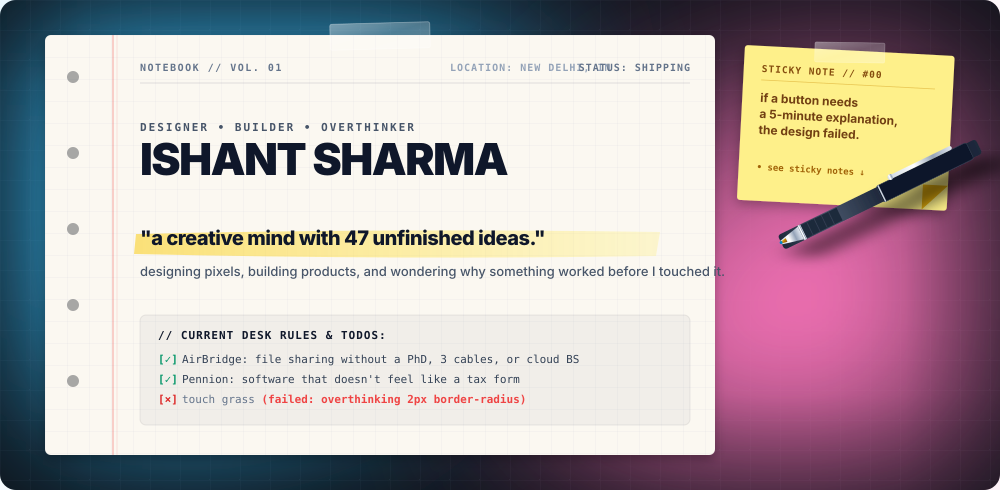

 

  

  &nbsp;
  &nbsp;
  &nbsp;
  &nbsp;
  &nbsp;
  

---

### Systems & Products

<table>
  <tr>
    <td width="33%" valign="top">
      <h4><a href="https://github.com/ursishant/airbridge">AirBridge</a></h4>
      
Peer-to-peer Wi-Fi continuity bridge connecting macOS &amp; Android. Zero cloud dependency, multi-stream parallel transfer engine with instant folder beaming.

      TypeScript • WebSockets • C Native
    </td>
    <td width="33%" valign="top">
      <h4><a href="https://github.com/ursishant/thumbgen">Thumbgen</a></h4>
      
Algorithmic YouTube packaging engine. Identifies narrative tension, crafts high-retention metadata, and generates AI production prompt directives.

      AI Integration • TypeScript • Automation
    </td>
    <td width="33%" valign="top">
      <h4><a href="https://pennion.com">Pennion</a></h4>
      
Design and software laboratory turning complex systems into fluid, human-first consumer products and robust digital experiences.

      Product Architecture • Design Systems
    </td>
  </tr>
</table>

---

### Stack & Applied Technologies

  

---

  
  

