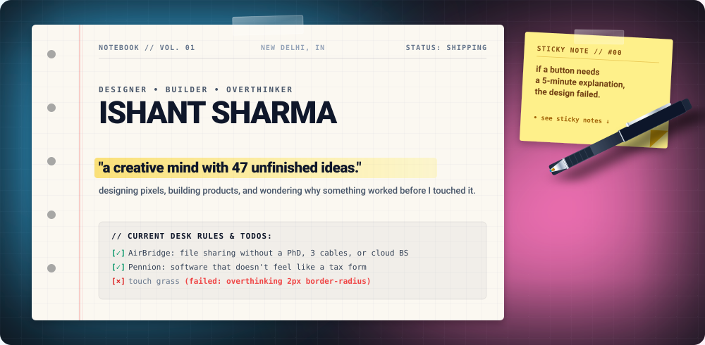
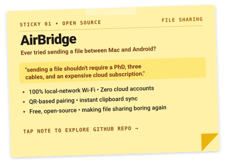
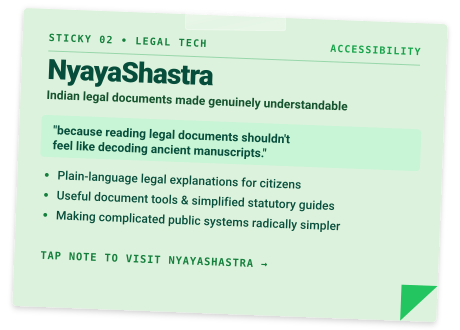
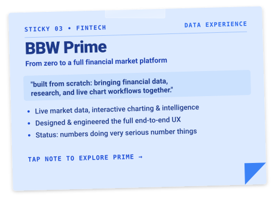
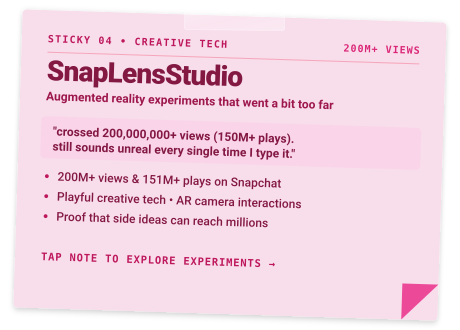
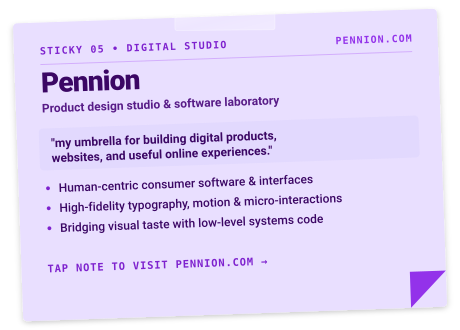
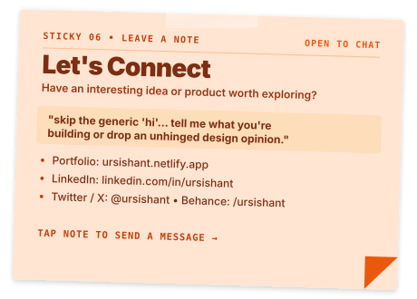

<div align="center">
  
</div>

<br/>

<p align="center">
  <a href="https://pennion.com"><b>pennion.com</b></a> &nbsp;&bull;&nbsp;
  <a href="https://ursishant.netlify.app/">portfolio</a> &nbsp;&bull;&nbsp;
  <a href="https://linkedin.com/in/ursishant">linkedin</a> &nbsp;&bull;&nbsp;
  <a href="https://x.com/ursishant">twitter / x</a> &nbsp;&bull;&nbsp;
  <a href="https://behance.net/ursishant">behance</a> &nbsp;&bull;&nbsp;
  <a href="mailto:hello@ursishant.netlify.app">get in touch</a>
</p>

<br/>

<div align="center">

> **A note from the desk:**
>
> "I built AirBridge because sending a file between two devices shouldn't require a PhD, three cables, and a cloud subscription. Anyway, it's free, open source, and lives on your local network. You're welcome."
>
> *Yes, I have a solution for problems I create myself.*

</div>

<br/>

### the sticky note wall

*things I made instead of touching grass.*

<p align="center">
  <a href="https://github.com/ursishant/airbridge"></a>
  <a href="https://nyayashastra.pennion.com/"></a>
</p>
<p align="center">
  <a href="https://prime.bigbreakingwire.in/"></a>
  <a href="https://github.com/ursishant"></a>
</p>
<p align="center">
  <a href="https://pennion.com/"></a>
  <a href="mailto:hi.pennion@gmail.com"></a>
</p>

<br/>

### the person behind the pixels

Hey! I'm **Ishant Sharma**, a designer, independent builder, and someone who finds it difficult to stick to just one creative discipline.

I started with graphic design, got curious about interfaces, started building websites, and somehow ended up creating software products. I enjoy the entire process: from a random idea scribbled in a notebook to a polished experience that people can actually use.

- Graphic designer with 5+ years of craft & systems experience.
- Exploring UI/UX, product design, and thoughtful digital interfaces.
- Building websites, SaaS tools, and local-first open-source experiments.
- Based in New Delhi, India &bull; Open to remote opportunities and collaborations.
- Powered by curiosity, caffeine, and an unhealthy number of open browser tabs.

---

### the creative toolbox

*some tools I use. some tools I keep opening just to stare at them.*

```
[design & visual]   Figma, Photoshop, Illustrator, Design Systems, Typography Architecture
[code & internet]   React, Next.js, TypeScript, Tailwind CSS, Node.js, WebSockets, P2P Sockets
[also exploring]    Blender 3D, AR camera technology, POSIX streams, macOS launchd
```

---

### random thoughts in the margins

<details>
<summary><b>Things I strongly believe in (click to unfold)</b></summary>

- Good design should make complex things feel effortless.
- If a button needs a 5-minute explanation, something went wrong.
- Ship first. Overthink later.
- A side project is just procrastination with a GitHub repository.
- The smallest details make the biggest difference.
- There is always one more pixel to fix.
- Not every idea needs to become a startup. Some can just be fun.

</details>

<details>
<summary><b>Things currently happening in my head</b></summary>

- Could this be a product?
- What if the interface had better micro-interactions?
- Let's try building it.
- Why is this CSS doing that?
- Maybe I should redesign the whole thing.
- I should probably go to sleep.

</details>

---

<p align="center">
  <sub>Ishant Sharma &bull; New Delhi &bull; Made with curiosity, caffeine, and an unreasonable amount of alignment guides.</sub>
</p>
